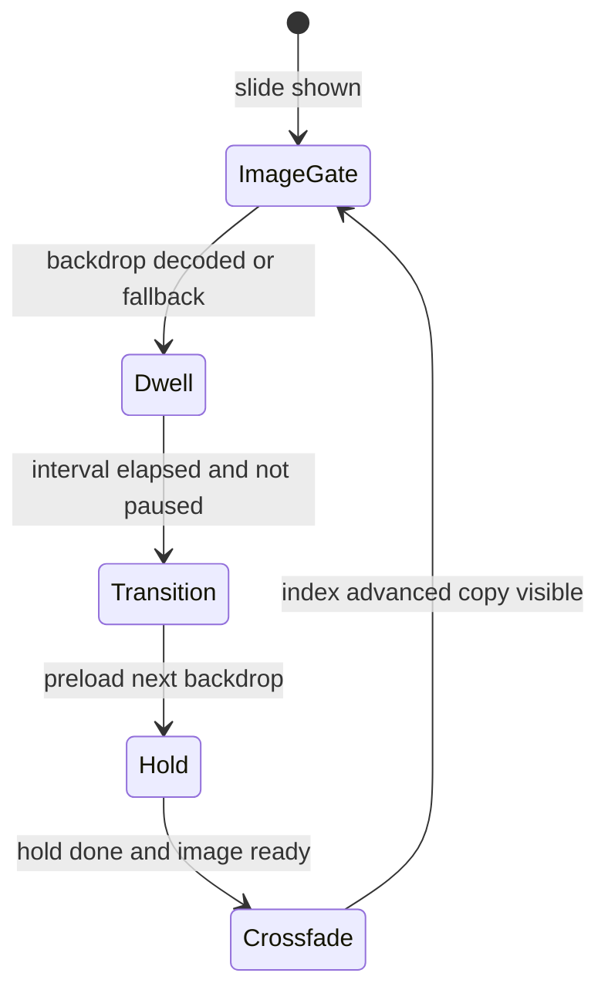

# Homepage hero (billboard)

Design contract for `app-homepage-hero`. **Read this before changing** `src/app/homepage-hero/**`, `hero-slides.ts`, or homepage CSS that affects billboard copy height / scroll.

Curation storage / KV API: [flix-prototype.md](./flix-prototype.md) — **out of scope** here.

## Purpose

Full-bleed featured-episode carousel: backdrop crossfade, Ken Burns (desktop), dwell auto-advance, curator controls, pager dashes, touch swipe (mobile).

## Design tensions (read first)

These goals fight each other. **All are required.** Fixes that only optimize one side regress the others.

| Goal | Why | Wrong “fix” |
|------|-----|----------------|
| **Stable height when description exists** (HERO-SCR-002) | Short vs long descriptions must not collapse the panel mid-autoplay | Stacked layouts reserve the collapsed desc lines (medium 4, mobile 3) on every slide (the expander is inline, no row); wide hugs the docked card |
| **No blank band when description is absent** (HERO-SCR-004) | Clips / short episodes often have **empty** `episodeDescription` — mobile shows a large black gap between meta and Watch | Empty `<p class="billboard__desc">` with `min-height`, or unconditional `min-height` on `.billboard__copy-body` |
| **No blank band under short titles** (HERO-SCR-005) | Stacked layout (≤1280) puts the title in normal flow; a 1-line title with a 3-line `min-height` leaves a large gap above the date/meta | `.billboard__title { min-height: calc(1.12em * 3) }` (or similar) on stacked layouts |

**Correct pattern**

1. Render `.billboard__desc` **only** when `hasFeaturedDesc` (trimmed text length > 0).
2. Render `.billboard__copy-body` **only** when there is a description **or** at least one public subject (`hasCopyBody`).
3. Apply reserved desc min-height **only** under `.billboard__copy-body.has-desc` (and `.billboard__desc` itself).
4. Title: `line-clamp: 3` as a **ceiling** only — **never** set title `min-height` to N lines. Accept 1–3 line height variance; keep `overflow-anchor: none` (HERO-SCR-001 / 003).
5. Keep `overflow-anchor: none` on `.billboard` when slides flip between short/long title or has-desc / no-desc.
6. `featuredDesc` is the **full trimmed** `/homepage` description. Do **not** run it through the search-card formatter (`formatSearchDescription` / `SEARCH_DESCRIPTION_SIZE`); the per-layout desc clamp (HERO-SCR-002) decides how much shows.
7. **Description expander** (HERO-DSC-001): the same icon expander as the discovery cards (`app-clampable-text`: `mat-icon-button`, 32px, `expand_more` / `expand_less`), placed **inline on the last visible line**: absolutely positioned at the bottom-right of `.billboard__desc-wrap` (which shrinks to the text column), centred on that line, over a short `#0b0b0b` fade (`.billboard__desc-fade`, `aria-hidden`) so it never sits on legible text. It takes **no row of its own** while collapsed (expanded it gets its own band: **HERO-DSC-003**). `mat-icon-button` keeps its 48px touch target. A real `<button>` with `aria-label` (Expand / Collapse description), `aria-expanded` and `aria-controls` → the desc `id`; rendered only when the collapsed text overflows its clamp. Overflow is measured in the browser only (SSR renders no toggle) after render, on window resize and on slide change. Expanding follows **HERO-DSC-002**. While expanded the hero does not auto-advance; any slide change collapses it.
8. **Expanded description** (HERO-DSC-002 / 005, all layouts): **the hero (art band, pager) and the page keep their height** (hero locked inline at its collapsed height, no layout shift) and **the card's top never moves** (HERO-DSC-005). Wide: the bottom-anchored card would grow upward in flow, so expanded the hero aligns it to the top (inline `align-items: flex-start`) and the card takes its measured collapsed offset below the search clearance as an inline `margin-top` (`cardTopPx`), so it is laid from exactly its collapsed top and grows down; stacked keeps its top in flow. No `translateY`. The pager is never covered where it sits above or beside the card (mobile, medium, wide); in short stacked windows (in-flow pager below the card) the card grows over it like it does over the stats strip. **Sizing, measured once at expand time** (C = collapsed description height, L = line height, VH = viewport height, G = gap from the card's bottom to the viewport foot less 12px, can be ≤ 0): expanded description height = **min(full text, C + clamp(G − B, minGrow, maxGrow))**, where B = the 40px chevron band under the text (HERO-DSC-003), with **minGrow = max(6 L, 30% VH)**, so expanding always grows noticeably, even when the card is already at or below the foot (it then runs past the foot, and the page is not auto-scrolled), and **maxGrow = max(minGrow, 60% VH − B)** (the card, text plus band, grows at most 60% VH), so the chevron is never more than ~60vh of page scroll from where it was and collapsing never needs a long scroll. Between the two the card fills exactly to the foot. The measuring and the maths are two self-contained pure functions in `src/app/homepage-hero/hero-desc-layout.ts`, `measureCollapsedDesc` (collapsed geometry at expand time) and `expandedDescLayout` (sizes), shared by the component and the layout harness (which serialises them), and unit-tested in `hero-desc-layout.spec.ts`. Short text just shows in full (no scroller); the rest **scrolls inside** (`overflow-y: auto`, `overscroll-behavior: contain`, `tabindex=0`). The card **overlays whatever follows the hero** (stats strip, rails): `.billboard.is-desc-expanded` gets `overflow-x: clip; overflow-y: visible` and **no z-index** (HERO-DSC-004); only the card is raised (`z-index: 4`, above `.catalogue` / `.nflx-rows` at 2, below the chrome), on an opaque `#0b0b0b` surface that ends with the card. The chevron is **outside** the scroller, in its own band under it (HERO-DSC-003), so it is visible at both scroll extremes and never over text. Page scroll carries the card like any content (no re-fit, never collapses on scroll); a height-only resize re-sizes it from the expand-time position; a width change collapses. Collapse and slide change clear the lock, the top alignment/offset and the height and reset `scrollTop` to 0, returning to the exact collapsed layout. (Earlier versions filled exactly to the foot and moved the card up to fit, which on mobile with the card near the foot covered the pager and grew nothing: Jon, 710b209. Later a `translateY` sized from the computed growth, description + 40px band, kept the wide card's top; the real in-flow growth could be smaller, so a tall wide card moved down ~32px when expanded: Jon, 27 Oct 2026, HERO-DSC-005.)
8a. **Expanded text vs scrollbar, URLs and chevron** (HERO-DSC-003): the expanded scroller keeps the text clear of its scrollbar (`scrollbar-gutter: stable` plus `padding-right: 16px`, border-box so it is no wider than collapsed; the padding also clears overlay scrollbar thumbs, e.g. Windows Chrome), long unbroken URLs wrap (`overflow-wrap: anywhere` on `.billboard__desc`, collapsed too; `overflow-x: hidden` expanded), and the chevron sits in a 40px band under the scroller (`.billboard__desc-wrap.is-expanded { padding-bottom: 40px }`, = `HERO_DESC_GROW.toggleBandPx`), so it never covers a line at any scroll offset. The collapsed fade is not rendered while expanded. (Jon, 27 Oct 2026: text ran under the scrollbar, URLs were cut off, the chevron covered the last line.)
8b. **Expanded hero vs the stats strip** (HERO-DSC-004): expanding never changes the art's box, the hero's box or the stats strip's position, and the art never paints over the strip. The strip (`.catalogue`, `z-index: 2`, `margin-top: -28px`) overlaps the hero's foot; a z-index on `.billboard.is-desc-expanded` made the whole billboard a stacking context above it, so the art band covered the strip's top (Jon, 27 Oct 2026). Only `.billboard__content` is raised. Sideways the billboard still clips (`overflow-x: clip`): unclipped, the stacked card's `100vw` panel scrolled the page sideways when a classic scrollbar shows.
9. **Service links** (HERO-SVC-001): the card's action row ends with the episode page's own service links: `app-episode-links` (with `[showShare]="false"`), the same component, icons, order (`collectEpisodeServices`: YouTube, Spotify, Apple Podcasts, BBC, Internet Archive, then any other catalogue services), `aria-label`s (service display names) and link behaviour (`target="_blank"`, `rel="noopener noreferrer"`) as the episode page. Only services the slide's episode has URLs or ids for are shown, taken from the homepage payload the hero is built from (`services`, `ids`, `svc`), and nothing is shown when there are none. They sit on the same row as Watch / Add to Queue on wide and medium (no extra row; HERO-WID-001 still holds) and on their own row under the stacked full-width mobile buttons. The icons take the card's text colour (styled in the shared component, so no hero CSS bytes are added). They work collapsed and expanded (HERO-DSC-002 still fills to the foot with the chevron visible).
10. **Add to Queue, no More info** (HERO-QUE-001): the action row is Watch/Listen, then the episode page's **Add to Queue** toggle, then the service links. There is **no More info** link. The toggle is the shared `app-queue-button` (`src/app/queue-button/`), the same component as the episode page, with the same rules as the search cards' icon button: shown only when the episode can play in-app (`canEmbedEpisode`; outbound-only Watch/Listen such as BBC Sounds or iPlayer has nothing to enqueue, so no button), for every visitor (the queue is local, so there is no sign-in or role check), and a click toggles the featured episode in `PlayerService`'s queue ("Add to Queue" / "Queued" as the visible text and accessible name, `aria-pressed` for the state, `playlist_add` / `playlist_add_check`; keyboard focus shows a 2px accent outline, distinct from the Queued accent border). It follows the current slide. A pointer click on it releases the focus pause (the button emits `toggled`; the hero blurs it, like the pager), so the hero resumes once the pointer leaves; keyboard activation keeps focus and the pause. Wide and medium: it sits on the same row as Watch and the service links (HERO-WID-001 unchanged). Mobile: it is a full-width stacked button under Watch, with the links below. The hero passes `shape="pill"`, so the button is rounded and as tall as Watch (the Material filled-button height token); the episode page keeps the default `square` shape (4px outline, 9px 16px padding, 40px), unchanged. The component has its own `queue-button.component.html` / `.sass`, so no hero CSS bytes are added. When nothing is playable, Watch links to the episode page as before.
11. **Title links to the episode page** (HERO-TTL-001): the title text is wrapped in `a.billboard__title-link` with the slide's `playableLink` (the URL More info used to open; every slide has one, including films and TV/news episodes). It keeps the title's look (inherited colour, no underline). Hover underlines it; keyboard focus (Tab from the show pill, Enter opens) shows an accent-coloured, thicker underline instead of an outline, because the 3-line clamp's `overflow: hidden` would clip an outline. It is its own link, separate from the show pill (which still goes to the show) and from the description expander (a separate button below). A touch swipe that starts on the title is ignored like any link (HERO-CTL-002).

**How to notice in review / QA**

- **HERO-SCR-004:** slide with no description and no subjects — meta should sit close above Watch (no multi-line empty band).
- **HERO-SCR-005:** slide with a short title (e.g. “The Rulo Farm”) on mobile/stacked — date/meta should sit close under the title, not after ~2 empty title lines.
- Automated: specs tagged `HERO-SCR-004` / `HERO-SCR-005` (DOM + Sass forbids title line-reservation `min-height`).

If you “fix scroll jump” by re-adding unconditional copy-body `min-height` or title `min-height: calc(1.12em * 3)`, you will recreate the mobile blank-space bugs.

## Key files

| Path | Role |
|------|------|
| `src/app/homepage-hero/homepage-hero.component.{ts,html,sass}` | Billboard UI, transitions, swipe, layout |
| `src/app/homepage-hero/homepage-hero.component.spec.ts` | Behaviour + CSS-contract regressions |
| `src/app/hero-slides.ts` | Build / prune curated week slides |
| `src/app/hero-curation.service.ts` | Client for `/hero-curation` |
| `src/app/hero-manage-dialog/*` | Curator reorder / remove |
| `src/app/homepage-api/homepage-api.component.ts` | Supplies `slides`, curation wiring |

## Requirements (stable IDs)

Use these IDs in PR notes and test descriptions.

| ID | Requirement | Automated? |
|----|-------------|------------|
| **HERO-SUB-001** | Every public subject (not `_`-prefixed) renders as a chip; no count/row cap in TS, template, or CSS | Yes |
| **HERO-SUB-002** | Watch/Listen + Add to Queue stay **after** the subject chip block in the DOM (stacked medium may show CTAs in a seam above copy via flex `order` — HERO-SCR-006) | Yes (DOM order; geometry when in-flow under chips) |
| **HERO-SCR-001** | `.billboard` (and dots viewport) set `overflow-anchor: none` | Yes (Sass contract) |
| **HERO-SCR-002** | When a description exists: title is 3-line clamped; desc is clamped per layout via `--hero-desc-lines` (**wide ≥1280: 5**, **medium 701–1280: 4**, **mobile ≤700: 3**). `.billboard__desc` and `.billboard__copy-body.has-desc` reserve that height on stacked layouts so **short** copy does not collapse the panel; wide (docked card) resets them to hug | Yes (Sass contract + e2e) |
| **HERO-WID-001** | Wide (≥1281): the hero stays one band (`min-height: min(88vh, 720px)`) with the docked card **bottom-anchored** at its flex-end. **Collapsed**, a tall card (3-line title + long description + chips) must not grow the hero: the browser drops the collapsed desc lines (5 → floor 2) via `--hero-desc-lines` on `.billboard__content` until the card fits (the inline expander needs no row, so it isn't counted). **Expanded**: HERO-DSC-002 — the band does not change; the card keeps its top and grows down over the stats strip (sized by the gap to the foot, within max(6 lines, 30vh) and 60vh), and the description scrolls inside. **Collapsing returns to the band exactly.** (Very short windows where even 2 lines don't fit may still grow collapsed, as before.) | Yes (unit + catalogue e2e `homepage-hero-desc.spec.ts`, harness `hero-layout.spec.ts`) |
| **HERO-DSC-002** | Expanded description, sized once on expand: card top fixed, pager not covered, hero height unchanged; description = min(full, C + clamp(gap to foot − 12px − 40px band, max(6 lines, 30vh), 60vh − band)), rest scrolls inside; overlays stats strip / rails; chevron outside the scroller, within 60vh of page scroll; page scroll moves it with the page (no re-fit, no collapse); collapse restores the exact layout | Yes (unit + catalogue e2e `homepage-hero-desc.spec.ts`) |
| **HERO-DSC-003** | Expanded: text ≥16px clear of the scrollbar (`scrollbar-gutter: stable` + `padding-right: 16px`), long URLs wrap (`overflow-wrap: anywhere`; no sideways scroll), chevron in its own 40px band under the scroller (never over a line) | Yes (unit Sass contracts + harness `hero-layout-expand.spec.ts` + catalogue e2e `homepage-hero-expand.spec.ts` / `homepage-hero-desc.spec.ts`) |
| **HERO-DSC-005** | Expanding never moves the card: its top stays within 1px of collapsed at every layout (wide: laid from its measured collapsed offset, `align-items: flex-start` + `margin-top`, no `translateY` sized from the growth); it grows down and may cover the stats strip | Yes (unit `hero-desc-layout.spec.ts` / `homepage-hero.component.spec.ts` + harness `hero-layout-expand.spec.ts` + catalogue e2e `homepage-hero-expand.spec.ts` at 1024 / 1440 / 1920 / tablet / mobile, very long notes, medium notes and a tall card) |
| **HERO-DSC-004** | Expanding keeps the art box, hero box and stats-strip position; the art never paints over the strip (no z-index on `.billboard.is-desc-expanded`, only the card raised); `overflow-x: clip` so nothing scrolls the page sideways | Yes (unit + harness `hero-layout-expand.spec.ts` + catalogue e2e `homepage-hero-expand.spec.ts`) |
| **HERO-SVC-001** | Hero card shows the episode page's service links (`app-episode-links`, no share) for the services the episode has, in the same order, labels and link behaviour; none when it has none; on the Watch / Add to Queue row (own row on mobile) | Yes (unit + catalogue e2e `homepage-hero-desc.spec.ts`) |
| **HERO-TTL-001** | Title is a link to the slide's episode page (`playableLink`), with the title look kept (inherited colour, no underline; hover underline; keyboard focus accent underline), separate from the show pill and expander | Yes (unit + catalogue e2e `homepage-hero-desc.spec.ts`) |
| **HERO-QUE-001** | No More info; the episode page's Add to Queue toggle (`app-queue-button`, `shape="pill"` in the hero, rounded and Watch height) after Watch, only when the episode embeds, toggling the player queue; same row as Watch and links on wide/medium, full-width stacked under Watch on mobile | Yes (unit + catalogue e2e `homepage-hero-desc.spec.ts`) |
| **HERO-KND-001** | News reports, TV show episodes and films say what they are: the eyebrow reads "Now featuring · News" / "· TV" / "· Film" rendered by the shared `app-content-kind-badge` (`content-kind-badge/`, input `kind`, optional `separator`), with the same icon the cards and search suggestions use (`contentKindIcon` / `contentKindLabel`: `newspaper`, `live_tv`, `movie`). Its scoped `.kind-badge__icon` rule (with `--mat-icon-size`) sizes the icon box to 1.25em rather than MatIcon's 24px. Podcast episodes show no badge. News and TV keep the icon in their parent pill, which links to `/news/{org}` or `/tv/{show}`; a film has no parent page, so it has no pill. Title and Watch links come from `withHeroLinks` (`cataloguePlayableLink`): `/news`, `/tv` and `/film` with the kind-prefixed short id | Yes (unit `content-kind-badge.component.spec.ts`, `homepage-hero.component.spec.ts`, `homepage-api.component.spec.ts` `withHeroLinks`; catalogue e2e `homepage-hero-desc.spec.ts`: links, same row as the eyebrow text, icon box size) |
| **HERO-SCR-003** | Changing slide while the page is scrolled must not yank `window.scrollY` | Manual |
| **HERO-SCR-004** | No description: omit empty desc; omit copy-body when no desc and no subjects; **never** reserve desc `min-height` without `.has-desc` — mobile must not show a blank band above Watch | Yes |
| **HERO-SCR-005** | Short titles must not reserve empty lines: stacked layout must **not** set `.billboard__title { min-height: N lines }` — meta follows the title tightly | Yes (Sass contract) |
| **HERO-CTL-001** | Stage / grain / scrim / vignette use `pointer-events: none` so pager stays clickable | Yes (Sass contract) |
| **HERO-CTL-002** | Touch swipe ignores links, buttons, pager, admin, actions | Yes |
| **HERO-CTL-003** | Hover pause only while the pointer is over the art hit-target (`.billboard__art-hover`) or pager/admin — **not** while over title/description/copy | Yes |
| **HERO-CTL-004** | Stacked medium (≤1280 and ≥701, tall): pager/admin on the framed art band. **Mobile (≤700):** pager/admin sit in-flow under the art frame (before title copy), not after Watch/description | Yes (e2e + Sass) |
| **HERO-SCR-006** | Stacked medium (701–1280, tall viewports): title/description stay under the art; Watch/Add to Queue sit in an in-flow seam under the frame (not on the pager) so primary CTAs stay above the fold | Yes (e2e + Sass) |
| **HERO-SWP-001** | Touch horizontal swipe ≥48px → `prevHero` / `nextHero` (existing transition; no drag animation); mouse ignored; `touch-action: pan-y` on billboard | Yes |
| **HERO-LIF-001** | Image gate blocks dwell until decode or 12s fallback | Yes |
| **HERO-LIF-002** | `restartHeroCycle` must not clear `heroContentTimer` / in-flight preload | Yes |
| **HERO-LIF-003** | Hold + crossfade: copy stays until next backdrop ready, then leaves with image | Yes |
| **HERO-LIF-004** | Reduced motion: immediate index jump, no cycle timer | Yes |
| **HERO-LIF-005** | Save-GPU: Ken Burns off, auto-advance on | Yes |
| **HERO-LIF-006** | Quiet slide refresh (same id sequence) does not rebuild layers | Yes |
| **HERO-CUR-001** | Curator manage / remove controls emit and stay in admin toolbar | Yes |

## Slide lifecycle



Constants (`HomepageHeroComponent`):

| Constant | Value | Meaning |
|----------|-------|---------|
| `heroIntervalMs` | 7500 | Dwell before auto-advance (`--hero-interval` for Ken Burns) |
| `heroImageFallbackMs` | 12000 | Safety gate if decode never completes |
| `heroContentHoldMs` | 450 | Hold current copy before leaving |
| `heroContentOutMs` | 550 | Must match `.billboard__feature.is-hidden` duration |
| `heroTransitionMs` | 1200 | Stage opacity / outgoing Ken Burns clear |
| `swipeThresholdPx` | 48 | Touch horizontal swipe → prev/next |

## Hard layout invariants

### Subjects (HERO-SUB-*)

- `featuredSubjects` filters only `_` prefixes — **no** `.slice` / max-count.
- `.billboard__subjects`: wrapping flex; **no** `overflow: hidden`, fixed `max-height`, or line-clamp.
- Actions (`.billboard__actions`) follow subjects in the DOM.

### Scroll stability vs empty copy (HERO-SCR-*)

See **Design tensions** above. Summary:

| Mechanism | Selector / rule |
|-----------|-----------------|
| `overflow-anchor: none` | `.billboard`, `.billboard__dots-viewport` |
| Title clamp 3 (ceiling only) | `.billboard__title` — **no** `min-height` reserving empty lines |
| Desc clamp `--hero-desc-lines` (5 / 4 / 3) + min-height | `.billboard__desc` — **only when rendered** |
| Reserved copy-body | `.billboard__copy-body.has-desc` only — **not** bare `.billboard__copy-body` |
| Empty slide | No `.billboard__desc`; no `.billboard__copy-body` if no subjects either |
| Wide absolute docking / narrow stacked band | media queries in the same Sass file |

**Forbidden regressions**

- Unconditional `min-height` on `.billboard__copy-body` (breaks HERO-SCR-004).
- Always rendering `<p class="billboard__desc">{{ featuredDesc() }}</p>` when the string is empty.
- `.billboard__title { min-height: calc(1.12em * 3) }` (or any N-line title reservation) on stacked layouts (breaks HERO-SCR-005 — short titles leave a blank band above meta).
- “Fixing” blank space by removing `.has-desc` min-height while a description **is** present (breaks HERO-SCR-002 for short text).

Unit tests assert Sass contracts + HERO-SCR-004 DOM behaviour. **HERO-SCR-003** remains a scrolled visual check.

### Controls & swipe (HERO-CTL-*, HERO-SWP-*)

- Full-bleed layers: `pointer-events: none`.
- Billboard: `touch-action: pan-y`.
- Swipe: touch/pen only; axis lock; ignore interactive targets via `isSwipeIgnoredTarget`.
- Hover pause (HERO-CTL-003): `.billboard__art-hover` + `.billboard__controls` only — not the whole `.billboard`.
- Stacked medium pager (HERO-CTL-004): absolute over `--hero-band-h` for 701–1280px (and viewport height ≥600). Mobile (≤700): flex `order` places controls under the art frame before copy. Pager uses `left`/`right` without `width: 100%` on medium so the next chevron is not clipped.
- Stacked medium CTAs (HERO-SCR-006): Watch/Add to Queue in an in-flow seam under the art (flex `order` before copy); title/description stay below; CTAs must not overlay the pager.

### Copy hierarchy

Eyebrow (with the kind badge for news, TV and film, HERO-KND-001) → podcast pill (none for a film) → title → meta → (optional description) → (optional subject chips) → Watch/Listen + Add to Queue + service links.

When description and subjects are both absent, actions follow meta directly.

## Known failure modes

| Symptom | REQ | How we catch |
|---------|-----|----------------|
| Subject chips missing / clipped | HERO-SUB-001 | Spec uncapped chips + Sass forbids subjects overflow/max-height |
| Actions above / mixed into chips | HERO-SUB-002 | DOM order: subjects before actions |
| Page jumps on advance | HERO-SCR-001/003 | Sass `overflow-anchor` + manual scrolled advance |
| Huge blank gap above Watch (esp. mobile, no description) | HERO-SCR-004 | Specs omit empty desc/copy-body; Sass reserves height only under `.has-desc` |
| Huge blank gap under short title (above date/meta) | HERO-SCR-005 | Sass contract forbids title N-line `min-height` |
| Short description collapses panel / jumpy actions | HERO-SCR-002 | Sass min-height on `.has-desc` / `.billboard__desc` |
| Chevron dead | HERO-LIF-002 | Spec: next chevron does not cancel content transition |
| Dwell stuck after pager | focus pause | Spec: releases chevron focus |
| Blank / text ahead of art | HERO-LIF-001/003 | Image gate + hold-until-ready specs |
| Can’t click dashes | HERO-CTL-001 | Sass `pointer-events: none` on stages |
| Hover over title pauses carousel | HERO-CTL-003 | Spec: leave on copy does not keep pause; art hover does |
| Pager below fold / after copy on stacked desktop | HERO-CTL-004 | e2e stacked-desktop: controls intersect art band |
| Wide hero grows / card jammed under the search, bottom below the fold (tall title + 5-line desc) | HERO-WID-001 | Catalogue e2e: collapsed hero height ≤ band and card anchored; collapse returns to the band |
| Expanding grows the hero / must scroll the page a long way to collapse; collapsed box empty after scrolling; expanded card stops at the hero bottom; changes shape on page scroll / collapses with text on screen; card moves up over the pager / expanding near the foot grows nothing | HERO-DSC-002 | Catalogue e2e (2,500+ char text with real-aspect art; wide / medium / mobile 390×844 and 500×833 with the card at the foot / 1024×460 with the strip in view / short window / 1440×900 tall gap): hero height and card top unchanged, pager uncovered, growth ≥ max(6 lines, 30vh) and ≤ 60vh, fills to the foot in between, lower area and strip hit the card, chevron within 60vh and visible at both scroll ends, page scroll keeps the shape, collapse restores |
| Expanding moves the card down (Jon, 27 Oct 2026: tall wide card, medium notes) | HERO-DSC-005 | Unit (top offset is the measured one whatever the growth; no shift) + harness + catalogue e2e at 1024 / 1440 / 1920 / tablet / mobile: card top within 1px, art / hero / strip unchanged, strip top painted by the strip or the card only |
| Expanding: the art covers the stats bar; text runs under the scrollbar; long URLs cut off; chevron over the last line; page scrolls sideways | HERO-DSC-003 / 004 | Harness + catalogue e2e with classic scrollbars at 1024 / 1440 / 1920 / tablet / mobile, long-URL show notes: art / hero / strip boxes unchanged, strip top painted by the strip or the card only, text right edge ≥16px left of the scrollbar at top / middle / end of the scroll, no sideways overflow (description or page), chevron rect hits no line |
| Pager after title block on mobile | HERO-CTL-004 | e2e mobile: controls under art, before title |
| Watch/Add to Queue below fold or clashing with pager | HERO-SCR-006 | e2e: play in seam under art; title under art; no overlap with pager |
| Next chevron clipped on stacked medium | HERO-CTL-004 | e2e: next nav visible in viewport |
| Scroll fights swipe | HERO-SWP-001 | `touch-action: pan-y` + swipe specs |
| Ken Burns on phone | HERO-LIF-005 | saveGpu spec |

## Layout geometry e2e (Playwright)

Unit tests cannot apply real CSS media queries / box geometry the way a phone does. Use:

```bash
npm run test:e2e:hero-layout
```

(runs `e2e/hero-layout.spec.ts` and `e2e/hero-layout-expand.spec.ts`; set `HERO_SCREENS_DIR` to save the expand screenshots)

(`npx playwright install chromium` once per machine.)

| Piece | Role |
|-------|------|
| `e2e/hero-layout.spec.ts` | Viewport × fixture matrix; geometry + visibility asserts |
| `e2e/hero-layout-expand.spec.ts` | Expanded description (HERO-DSC-002..005) with classic scrollbars, very long / medium notes and a tall card: card top kept (shared checks in `e2e/hero-expand-geometry.ts`); art / hero / strip unchanged and strip not painted over; text clears the scrollbar; no sideways overflow; chevron off the text |
| `e2e/hero-layout/fixtures.ts` | Episode configs (empty desc, many subjects, short/long title, **very long show notes with long URLs** and the expander); mock stats strip + rails markup |
| `e2e/hero-layout/build-harness.ts` | Compiles **real** `homepage-hero.component.sass` (`:host` → `.hero-layout-host`) and `homepage-catalogue.component.sass` (mock strip); injects an expander script that mirrors `toggleDesc` using the component's own `measureCollapsedDesc` and `expandedDescLayout` (`window.heroLayoutHarness.toggleDesc()`, or click the chevron) |

**Viewports:** mobile (390×844), mobile-landscape (844×390), tablet (768×1024), stacked-desktop (1100×800), wide (1440×900), **full-hd (1920×1080)**; expand suite: 1024×700, 1440×900, 1920×1080, 768×1024, 390×844.

**Fixtures include:** no description; many subjects (12) with and without description; very long description with long URLs (`very-long-desc-with-urls`, expandable).

Tagged to **HERO-SCR-002 / 004 / 005**, **HERO-SUB-001 / 002** and **HERO-DSC-001..004**. Keep fixture HTML (including the desc wrap / fade / toggle) and the expander script aligned with `homepage-hero.component.html` / `.ts`.

## Soft guideline — style budget

Prefer compiled hero styles under ~16 kB; hard `anyComponentStyle` error budget is **17 kB** (`angular.json`). Do not sacrifice a layout invariant to shave a few hundred bytes.

## Regression checklist

**Automated**

- [ ] `ng test` filter `HomepageHeroComponent` (HERO-* unit / Sass contracts)
- [ ] `npm run test:e2e:hero-layout` (geometry: mobile / landscape / tablet / stacked / wide / full-hd × empty-desc & many-subjects; expanded long-URL description vs strip / scrollbar / chevron)

**Manual**

- [ ] **HERO-SCR-004:** mobile / narrow — slide with empty description and no subjects: no large blank band between meta and Watch
- [ ] **HERO-SCR-005:** mobile / stacked — short title (1 line): date/meta tight under title, not after empty title lines
- [ ] **HERO-SCR-002:** slide with a 1-line description still keeps actions from jumping up relative to a description that fills the clamp (reserved height when `.has-desc`)
- [ ] HERO-SCR-003: scroll hero partly off-screen; advance; no jump
- [ ] Long vs short title visually stable; descenders OK
- [ ] Mobile: swipe vs vertical scroll; CTAs still tappable
- [ ] Many subjects: all visible; actions still below

## Out of scope

- Hero KV / Auth0 / M2M — [flix-prototype.md](./flix-prototype.md), Api `docs/hero-curation-m2m-edge.md`
- Subject / day rails below the fold (except when they affect hero scroll)
