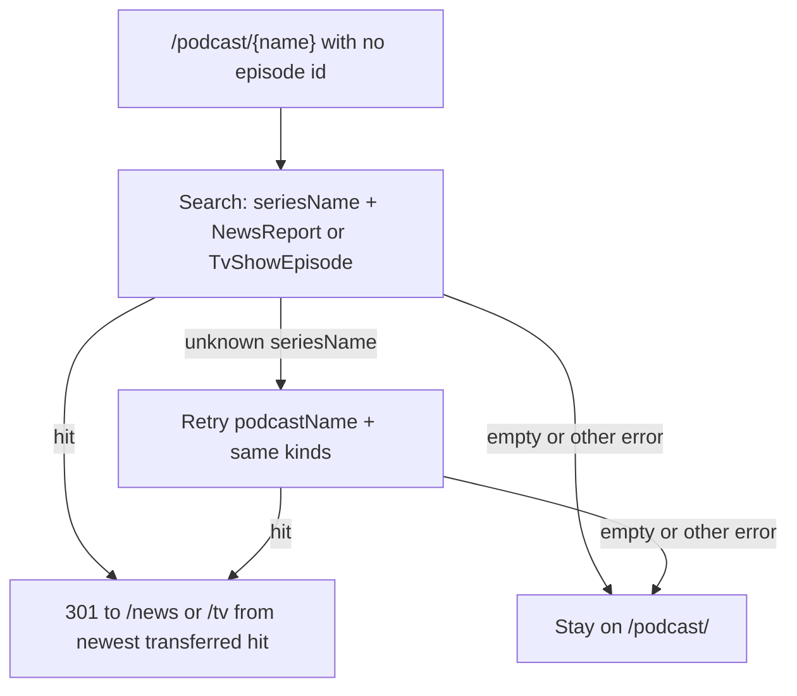
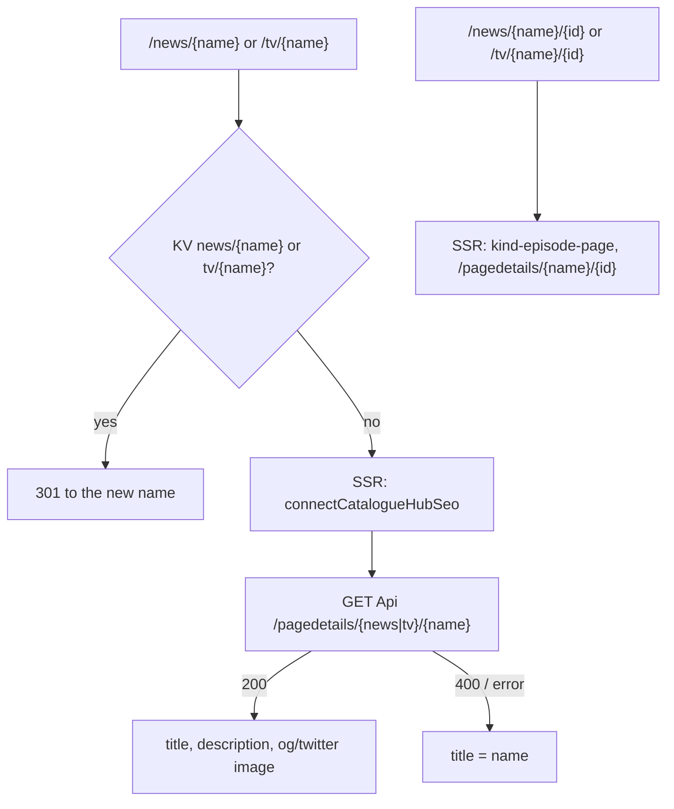

# Series hubs and moved-kind redirects

`/tv/{name}` and `/news/{name}` browse a transferred series the same way `/podcast/{name}` browses episodes: Search `count` in the heading, subject pills, and infinite scroll via `InfiniteScrollStrategy` (`getTake(1)` is 20, then 100) plus `ScrollDispatcher`.

Old `/podcast/{name}` links 301 to a hub only when Search still has **transferred parent kinds** (`NewsReport` or `TvShowEpisode`). Film is not a parent. Remaining `Episode` rows are not a reason to leave the podcast page.

## Hub menu

The hub toolbar has the same menu as the podcast page (`SeriesHubMenuComponent`). The trigger shows the sort order.

| Item | Who | Calls | Flag (`environment.catalogueParentCuration`) |
|------|-----|-------|------|
| Edit News Outlet / Edit TV Show | Curator | `GET` then `PATCH /newsorganisation/{id}` or `/tvshow/{id}` (curate). Only changed fields are sent; rename is not in this form. Saving `Removed` asks for confirmation first | `edit` |
| Submit Url for News Outlet / TV Show | Curator | `GET /{root}/{name}` for the id, then `POST /submit { url, parentKind, parentId, parentName }`. See [Submit URL flows](submit-url-flows.md#submit-to-this-news-outlet-or-tv-show) | `submit` |
| Rename News Outlet / TV Show | Admin | `POST /newsorganisation/name/{name}` or `/tvshow/name/{name}` with `{ newName }` (admin scope) | `rename` |
| Newest first / Oldest first | Everyone | Search `orderby` `release desc` / `release asc` | always |

The edit dialog uses the podcast edit dialog's tabbed layout and styles (`mat-tab-group`, full-width fields):

| Tab | Fields |
|-----|--------|
| Details | Spotify Id, Apple Id (blank sends `nullAppleId: true`), YouTube channel id, YouTube playlist id (+ read-only previous playlist ids) |
| Flags | Removed (confirm dialog: every report / episode is hidden) |
| Subjects | Default subject and ignored subjects (the podcast dialog's `/subjects` selects with typing filter), ignored associated subjects, known terms |
| Social | Twitter, Bluesky, hashtags, enrichment hashtags |
| Meta | Publisher, description, language (the podcast dialog's `/languages` select; "No Language" sends blank), search terms |
| Identity (TV only) | IMDb and TheTVDB URLs |

## News report and TV episode edit

The news report and TV episode pages render `PodcastEpisodeComponent` with `emitCuratorEdit`, so the curator
**Edit Episode** item opens `EditNewsReportDialogComponent` / `EditTvShowEpisodeDialogComponent` instead of the
podcast Edit Episode dialog (which calls the podcast-only `GET /episode/{podcast}/{id}`). The same dialogs open from
the submit snackbar's **Edit**.

| Call | Purpose |
|------|---------|
| `GET /newsreport/{id}` or `/tvshowepisode/{id}` (curate) | Playable fields, parent id/name, and IMDb / TheTVDB for TV |
| `GET /subjects`, `/people`, `/languages` | Same lookups as the podcast Edit Episode dialog |
| `GET /newsorganisation/{parentId}` or `/tvshow/{parentId}` | Parent default subject, hoisted in the subject select (best-effort) |
| `PATCH /newsreport/{id}` or `/tvshowepisode/{id}` (curate) | Only the changed fields (`PlayableFieldsChangeRequest`); 202 |

Both dialogs share `PlayableEditFieldsComponent` (the tab group) and `PlayableEditDialogBase` (load / save), laid out
like the podcast Edit Episode dialog:

| Tab | Fields |
|-----|--------|
| Details | Parent (read-only), title (required), description |
| Flags | Posted (behind the `redditPost` switch), Tweeted, Bluesky remove (`unBluesky`), Ignored, Removed, Explicit |
| Meta | Release (date), duration (`h:mm:ss`), subjects, search terms, hash tag, language (English = unset, sends `""`) |
| Guests | Guest select, Add person / Edit person |
| Identity (TV only) | IMDb and TheTVDB URLs (omit = unchanged, `""` clears). Replaces the old identity-only dialog |

There are no Urls / Images tabs: the playable PATCH does not edit service links. Parents are not renamed here.

On these pages the curator menu has no **Post Episode** (it is podcast-only), and the search bar is not scoped to the
outlet / show: a search goes to `/search/{term}`. The `/episodes/{ids}` review page links rows by `contentKind`
(`/news`, `/tv`, `/film` with the short id); it needs `GET /episode/{id}` to return `contentKind` for other kinds.

Film edit is not wired yet.

There is no Index item: there is no indexer endpoint for a news outlet or TV show yet.

Flags are on in every environment (dev, local, staging and production) now that each item's backend is live. Set one to `false` to hide that item. The empty hub ("There were no results") shows a **Curate** trigger with only the curation items, so a curator can still submit to an outlet with no reports yet.

## Renamed hub redirect

An admin rename makes RPP write KV `news/{old}` or `tv/{old}` → `{new}` in the Pages `redirects` namespace. The Pages Worker (`server.ts` → `renamedSeriesRedirect` in `src/app/kv-redirect.ts`) 301s:

- `/news/{old}` and `/tv/{old}` (optional trailing slash, query kept) to `/news/{new}` / `/tv/{new}`.
- Exact hub paths only. `/news/{old}/{id}`, `/tv/{old}/{id}` and `/film/…` are not redirected.
- Podcast redirects are unchanged: KV key `{old}`, the rest of the path kept.

`_routes.json` sends `/news/*` and `/tv/*` to the Worker. Before this they fell through to the prerendered homepage (wrong meta, homepage `ng-state`).

## Server render and meta

`/news/*` and `/tv/*` are server-rendered like `/podcast/*`:

- Hubs: `connectCatalogueHubSeo` (`src/app/catalogue-hub-seo.ts`) calls Api #175's `/pagedetails/{news|tv}/{name}` on the server. The list itself stays in the client `@defer`, so the server renders the loading placeholder.
- Report / episode pages already had the server page-details branch in `kind-episode-page.ts`; it now runs.
- `/film/*` is not routed to the Worker yet.
