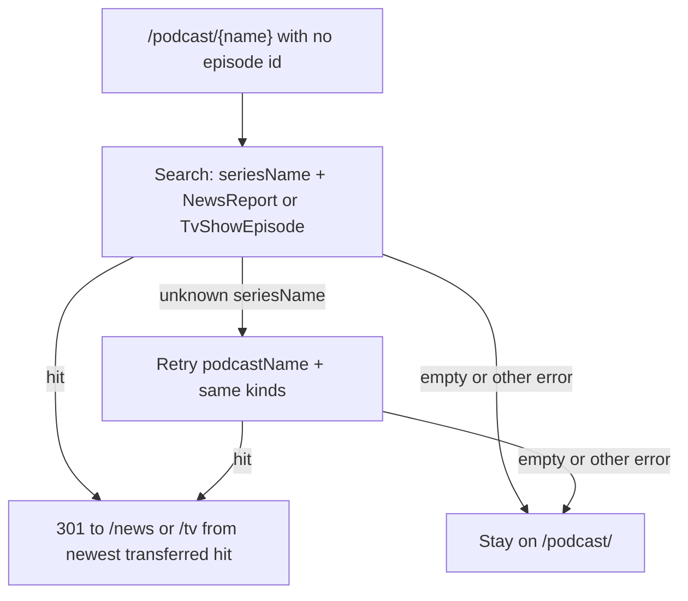

# Series hubs and moved-kind redirects

`/tv/{name}` and `/news/{name}` browse a transferred series the same way `/podcast/{name}` browses episodes: Search `count` in the heading, subject pills, and infinite scroll via `InfiniteScrollStrategy` (`getTake(1)` is 20, then 100) plus `ScrollDispatcher`.

Old `/podcast/{name}` links 301 to a hub only when Search still has **transferred parent kinds** (`NewsReport` or `TvShowEpisode`). Film is not a parent. Remaining `Episode` rows are not a reason to leave the podcast page.

## Hub menu

The hub toolbar has the same menu as the podcast page (`SeriesHubMenuComponent`). The trigger shows the sort order.

| Item | Who | Calls | Flag (`environment.catalogueParentCuration`) |
|------|-----|-------|------|
| Edit News Outlet / Edit TV Show | Curator | `GET` then `PATCH /newsorganisation/{id}` or `/tvshow/{id}` (curate). Only changed fields are sent; rename is not in this form | `edit` |
| Submit Url for News Outlet / TV Show | Curator | `GET /{root}/{name}` for the id, then `POST /submit { url, parentKind, parentId, parentName }`. See [Submit URL flows](submit-url-flows.md#submit-to-this-news-outlet-or-tv-show) | `submit` |
| Rename News Outlet / TV Show | Admin | `POST /newsorganisation/name/{name}` or `/tvshow/name/{name}` with `{ newName }` (admin scope) | `rename` |
| Newest first / Oldest first | Everyone | Search `orderby` `release desc` / `release asc` | always |

There is no Index item: there is no indexer endpoint for a news outlet or TV show yet.

Flags are on in dev/local and off in staging/production until the backend for each item is live. The empty hub ("There were no results") shows a **Curate** trigger with only the curation items, so a curator can still submit to an outlet with no reports yet.

## Renamed hub redirect

An admin rename makes RPP write KV `news/{old}` or `tv/{old}` → `{new}` in the Pages `redirects` namespace. The Pages Worker (`server.ts` → `renamedSeriesRedirect` in `src/app/kv-redirect.ts`) 301s:

- `/news/{old}` and `/tv/{old}` (optional trailing slash, query kept) to `/news/{new}` / `/tv/{new}`.
- Exact hub paths only. `/news/{old}/{id}`, `/tv/{old}/{id}` and `/film/…` are not redirected.
- Podcast redirects are unchanged: KV key `{old}`, the rest of the path kept.

`_routes.json` sends `/news/*` and `/tv/*` to the Worker for this. With no redirect, those paths get the CSR shell (no SSR), as they were client-rendered from the static fallback before.
